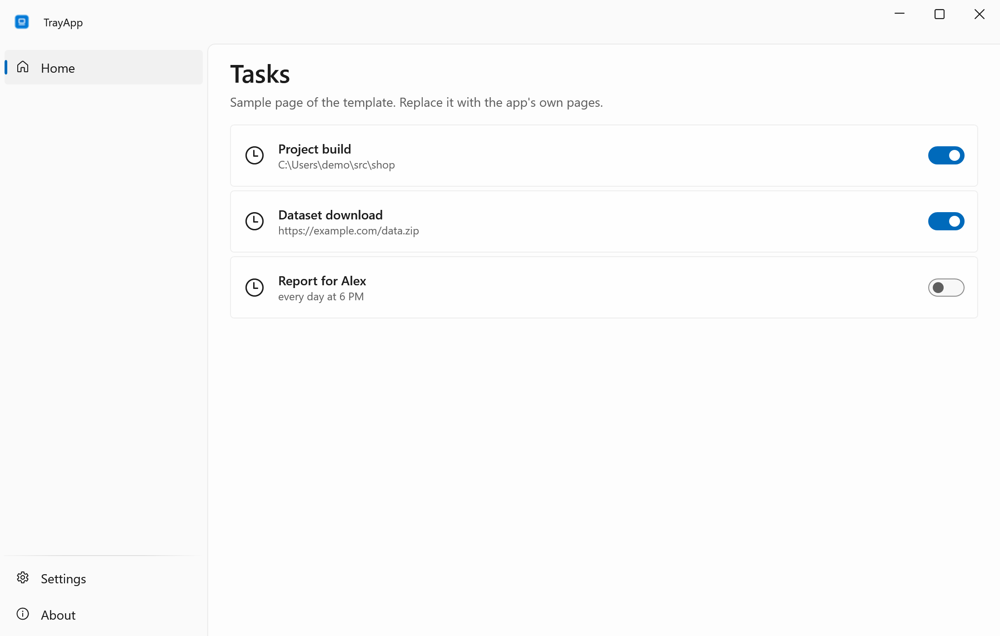
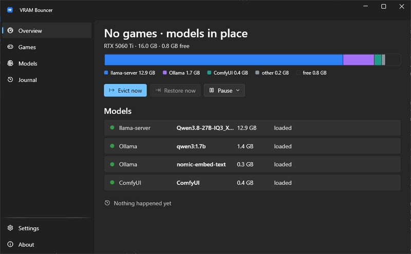
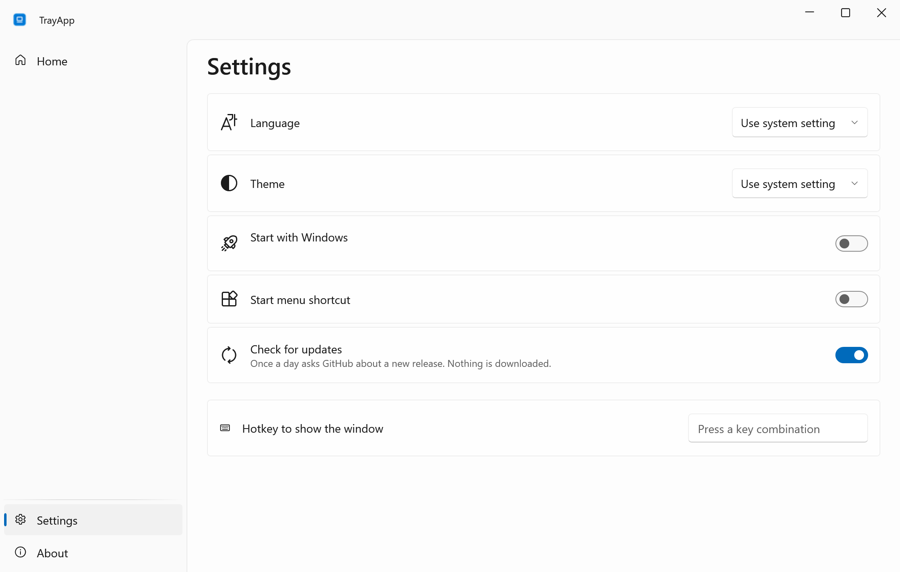
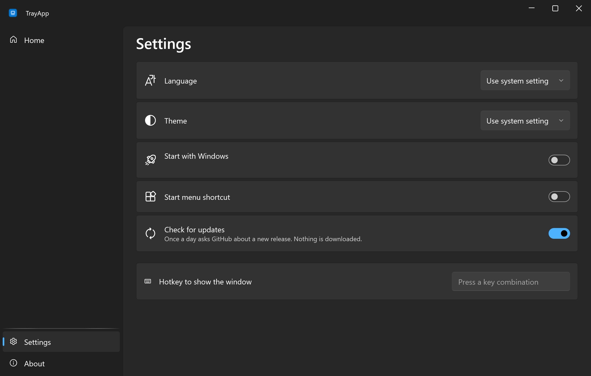
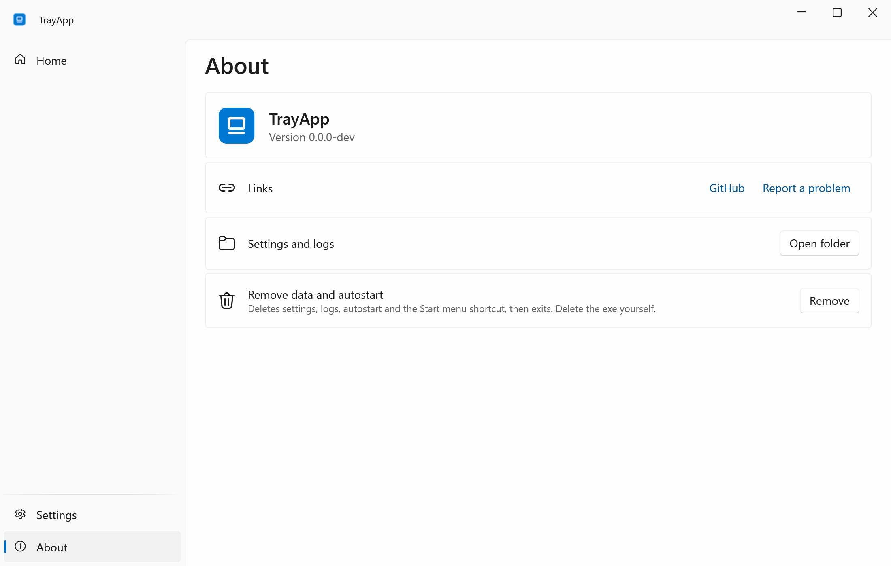
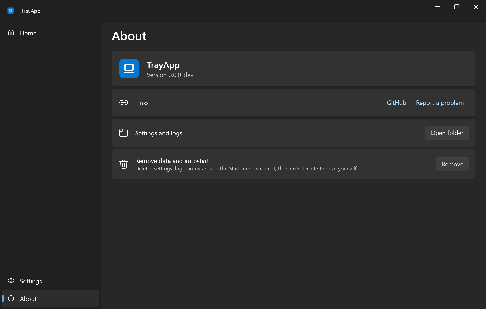

<div align="center">


# TrayApp

**Skeleton for small Windows tray apps: one exe, RU/EN, light and dark, releases from CI.**

**English** · [Русский](README.ru.md)

[](https://github.com/lojekq/TrayAppTemplate/releases/latest)
[](https://github.com/lojekq/TrayAppTemplate/releases)
[](https://github.com/lojekq/TrayAppTemplate/actions/workflows/ci.yml)

[](LICENSE)

<picture>
  <source media="(prefers-color-scheme: dark)" srcset="docs/main-dark-en.png">
  
</picture>
</div>

<!-- template -->
## Template

This repository is the template for eight tray apps by lojekq. `tools/rename.ps1` removes this section from an app.

**New app:** `gh repo create lojekq/MyApp --private --template lojekq/TrayAppTemplate`, clone, then
`pwsh tools/rename.ps1 -Name MyApp -Display "My App"`. The eight apps of the set are created by `pwsh tools/new-repos.ps1 -Root <folder>`.
After the fan-out the template is frozen: a fix to `Shell/` goes into this repo and a line into `template-fixes.md`.

**Layout:** `src/TrayApp/Shell/` is the shared frame (do not edit it in an app), `Features/` is the app,
`Demo/` holds `--demo` data and the `--autoplay` scenario, `Resources/` the EN and RU strings.
Extension points: verbs in `Program.Verbs`, `partial class Settings`, `SettingsPage.AppSection`, `Tray.Create(..., appItems)`,
`App.Exiting`, `App.ConfirmExit`, `App.RemoveData`, pages in `MainWindow.xaml`; `Features/SampleSettings.cs` shows a settings section with a hotkey.
Helpers in `Shell/` for two or more apps (00-shared §2.4): `MessageWindow`, `Hotkeys` + `HotkeyBox`, `AtomicFile`, `Install`, `ProcessInfo`,
`CmdLine`, `ConsoleTool`, `UserBusy`, `Monitors`, `TopWindows`, `WinEvents`, `ExeIcon`, `UninstallEntries`, `Paths`; signing: `tools/sign-release.ps1`.

| Command | What it does |
|---|---|
| `dotnet test` | tests, Microsoft.Testing.Platform via `global.json` |
| `pwsh tools/shots.ps1 -Pages main,settings,about` | screenshots `docs/<page>-<theme>-<lang>.png` at 2×, under the desktop lock |
| `pwsh tools/gif.ps1 [-Lang ru] [-Scene]` | `docs/demo-<lang>.gif` of the window (or of a fixed area), under the desktop lock |
| `pwsh tools/social.ps1 -Title ... -Subtitle ...` | `docs/social.png` 1280×640 for the social preview |
| `git tag -a v0.1.0 -m "..." -m "---" -m "..."` + push | CI builds the exe and zip, SHA256SUMS, attestation, release |

**Spikes (phase 1, 2026-10-21, .NET SDK 10.0.402, Windows 11 26300):**
- An MSTest.Sdk 4.5.1 test project references the WPF WinExe project (`net10.0-windows`): `dotnet test` passes in Debug and Release, WPF types load in tests. MSTest.Sdk needs `<ImplicitUsings>enable</ImplicitUsings>` for `[TestClass]` without `using`.
- A WinExe started with redirected stdio (node `child_process.spawn` with pipes, as Claude Code starts MCP servers, with and without `windowsHide`; and a pwsh pipe) reads and writes through `Console.OpenStandardInput/Output`: JSON lines, Cyrillic and a 1 MB line arrive intact, the exit code comes back. No console window: `GetConsoleWindow()` is 0, PE subsystem 2 (GUI).
- Trial tag `v0.0.1-test` with immutable releases on: CI built both files (self-contained exe 64.6 MB, framework-dependent zip 3.0 MB), SHA256SUMS matched, `gh attestation verify` passed for the exe and the zip, the pre-release was created and is immutable, notes came from the annotated tag, Defender found nothing, the downloaded exe started. The release and the tag were then deleted (allowed with immutable releases).
- Pipeline on this demo window at 100 %: `shots.ps1` (12 PNG, 2200×1400), window GIF EN/RU (800×496, 0.3 MB), scene GIF on `-offset_x 1080 -offset_y 344` (region hit exactly; not committed: the desktop around the window is in the frame), `social.ps1` (42 KB). Not checked yet: `shots.ps1` and `gif.ps1` on a 150 % monitor (waits for the owner's display slot).
- Helpers on the owner's PC: `Monitors.Snapshot()` returns exactly `Layouts.Owner`; `RegisterHotKey` on a combination held by another process gives error 1409 and the box shows "taken by another program".

**Decisions taken in the template (deviations from the spec):**
- CsWin32 0.3.358: 0.3.366 is younger than two weeks (00-shared §2.1).
- `MessageWindow` is a hidden top-level tool window, not `HWND_MESSAGE`: message-only windows do not receive broadcasts (WM_SETTINGCHANGE, WM_DISPLAYCHANGE, WM_POWERBROADCAST).
- Task Manager's "disabled" is an odd first byte in `StartupApproved\Run` (0x03, 0x07), not "≠ 0x02": 0x06 means enabled too.
- `shots.ps1` takes the desktop lock as well: its topmost window would get into another session's GIF.
<!-- /template -->

## Why

Every small Windows utility needs the same boring parts: a tray icon, settings, autostart, two languages, a crash log and a release with checksums.
TrayApp has them done once, so an app only adds its own pages.

## Features

- **Tray first** — left click opens the window, the cross hides it, Exit is in the tray menu.
- **One exe** — no installer and no admin rights; a Start menu shortcut and autostart are switches in Settings.
- **English and Russian, light and dark** — follows Windows or your choice.
- **Honest updates** — once a day it asks GitHub about a new release, shows a note and downloads nothing.
- **Crash log** — if it fails, it stops and shows where the log is; nothing is sent anywhere.

## See it in action



## Screenshots

| | Light | Dark |
|---|---|---|
| Settings |  |  |
| About |  |  |

## Download

1. Get **`TrayApp-x.y.z-win-x64.exe`** from [Releases](https://github.com/lojekq/TrayAppTemplate/releases/latest). Single file, no install, no admin.
2. Smaller build: `TrayApp-x.y.z-win-x64-fd.zip` (needs [.NET Desktop Runtime 10](https://dotnet.microsoft.com/download/dotnet/10.0)).
3. Optional check: `gh attestation verify <file> -R lojekq/TrayAppTemplate` or compare with `SHA256SUMS.txt`.

Requirements: Windows 11 x64. Windows 10 22H2 should work but is not tested.

## First run

Put the exe into a permanent folder first, for example `%LOCALAPPDATA%\Programs\TrayApp\`: autostart and the shortcut point to it.
On the first start Windows may show a SmartScreen warning (see FAQ). The app then lives in the tray; turn on **Start with Windows** in Settings.

## Settings

| Setting | Default | What it does |
|---|---|---|
| Language | Windows language | English or Russian, applied after a restart |
| Theme | Windows theme | Light or dark |
| Start with Windows | off | Starts minimized to the tray |
| Start menu shortcut | on when the exe is in `%LOCALAPPDATA%\Programs\TrayApp\` | A shortcut in the Start menu |
| Check for updates | on | Once a day asks GitHub about a new release |

Settings and logs live in `%APPDATA%\TrayApp`.

## FAQ

<details><summary>Windows protected your PC / SmartScreen warning</summary>

The exe is not code-signed yet, so Windows does not know the publisher. Click **More info → Run anyway**.
Every file is built by GitHub Actions from this repository; you can check it with `gh attestation verify` or `SHA256SUMS.txt`.
Smart App Control, if it is on, blocks unsigned files with no way to allow one; the only option is to turn it off.
</details>

<details><summary>My antivirus flags it</summary>

It is a false positive: the app has no installer, no packer and no obfuscation. Please report it to your antivirus vendor
and open an issue with the detection name and the SHA256 of the file.
</details>

<details><summary>How do I uninstall?</summary>

About → **Remove data and autostart**, then delete the exe.
</details>

## Privacy

No telemetry. The only network request is the update check: `GET https://api.github.com/repos/lojekq/TrayAppTemplate/releases/latest` once a day; turn it off in Settings.
Logs contain no window titles, paths or other personal data.

## Build from source

```powershell
winget install Microsoft.DotNet.SDK.10
git clone https://github.com/lojekq/TrayAppTemplate
cd TrayAppTemplate
dotnet run --project src/TrayApp
dotnet test
```

## License

MIT © 2026 lojekq
