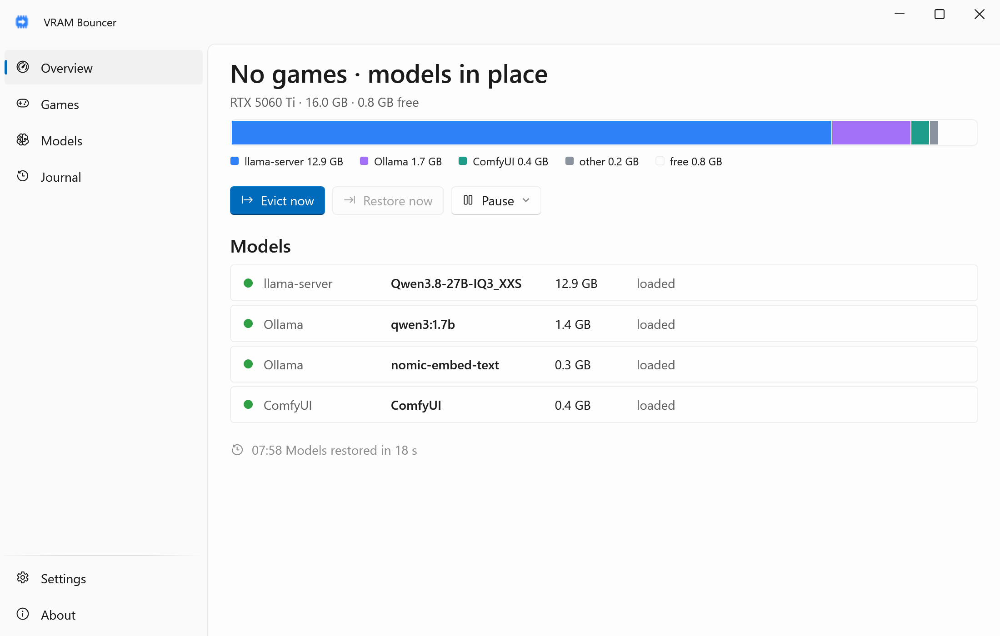
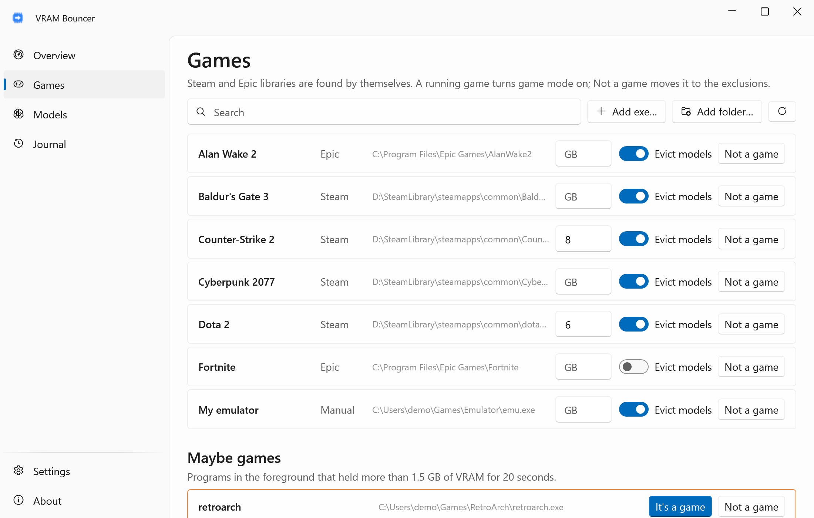
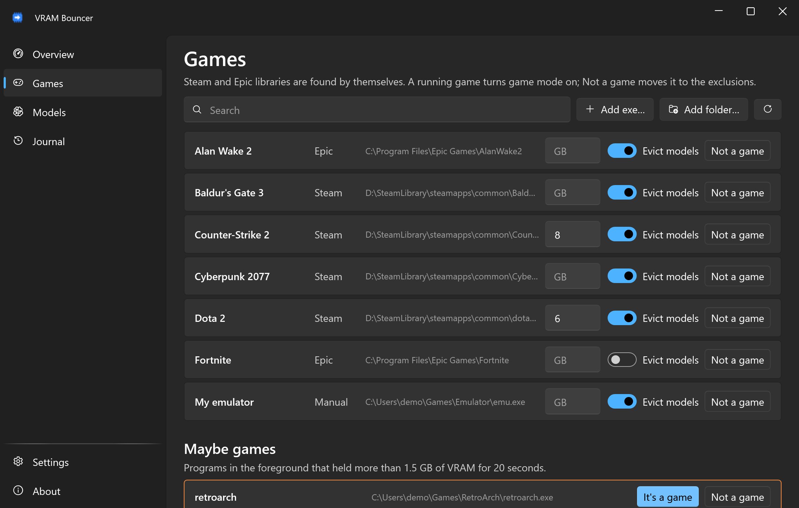
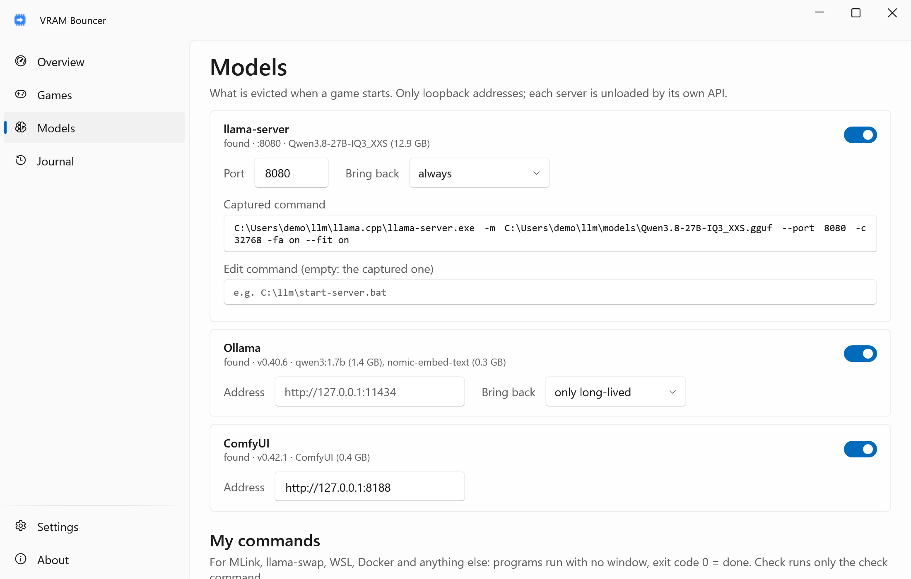
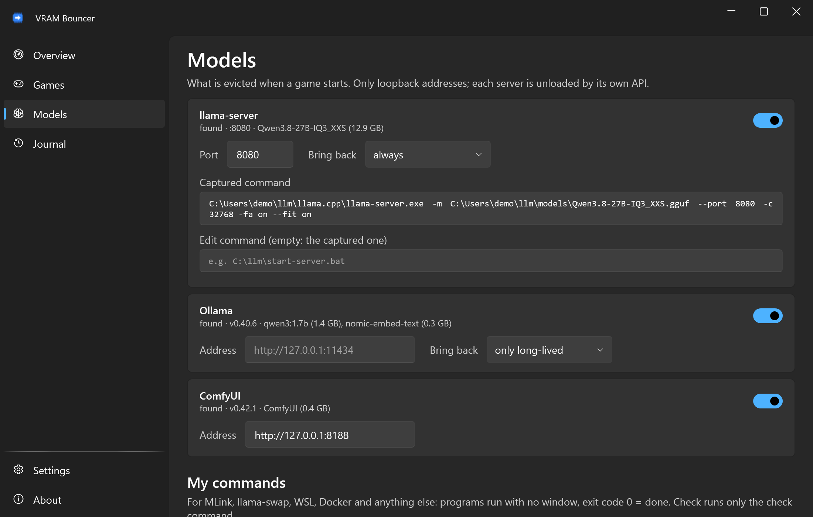
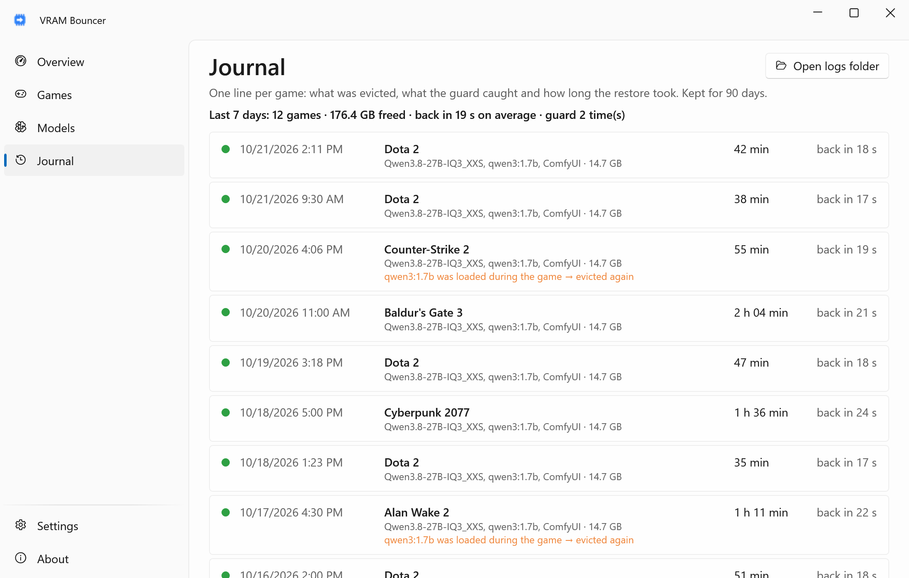
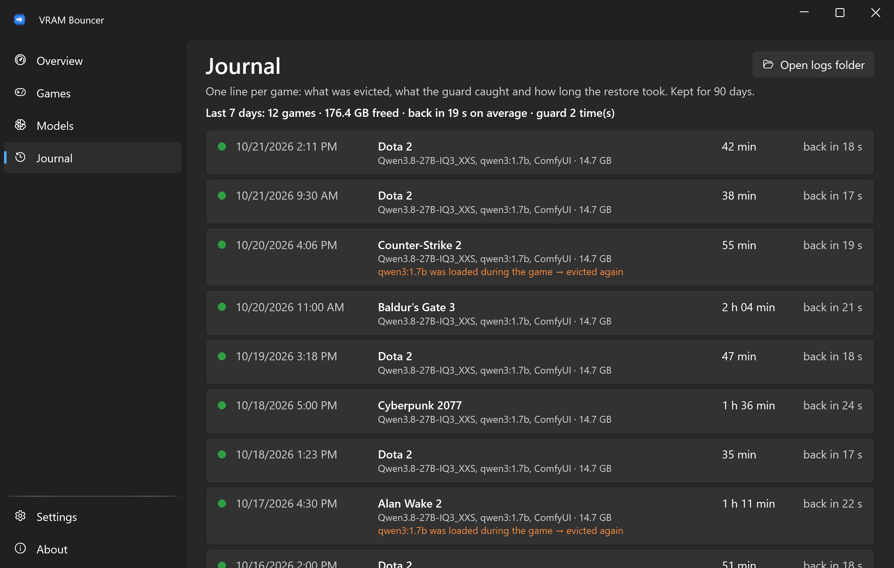

<div align="center">


# VRAM Bouncer

**Your games get the VRAM. Your local LLMs come back when you're done.**

**English** · [Русский](README.ru.md)

[](https://github.com/lojekq/VramBouncer/releases/latest)
[](https://github.com/lojekq/VramBouncer/releases)
[](https://github.com/lojekq/VramBouncer/actions/workflows/ci.yml)

[](LICENSE)

<picture>
  <source media="(prefers-color-scheme: dark)" srcset="docs/overview-dark-en.png">
  
</picture>
</div>

## Why

A local LLM in llama-server or Ollama happily sits on 13 GB of a 16 GB card, and the game you start gets the rest: stutter, low FPS, crashes.
VRAM Bouncer notices the game, unloads the models with each server's own API, and loads the same models with the same settings once the game is closed.

## Features

- **Finds your games** — Steam and Epic libraries are read by themselves; anything else is one click (an exe or a folder).
- **Unloads the right way** — Ollama, llama-server and ComfyUI through their own API; for everything else (MLink, llama-swap, WSL, Docker) there are your own commands.
- **Brings back the same model** — the same context size and keep-alive, only after the game is closed and the VRAM is really free.
- **Guard** — if something loads a model in the middle of a match, it is evicted again, and the journal shows what and when.
- **Survives crashes, sleep and reboots** — what was evicted is written to disk before anything is unloaded.
- **No admin rights, no telemetry, nothing injected into games** — safe for anti-cheats.

## How it works

Every 2 seconds it compares running processes with the folders of your game libraries (`steamapps\common\…`, Epic install folders, your own entries).
When a game starts, it writes a snapshot of the loaded models to `%APPDATA%\VramBouncer\state.json` and unloads them: `keep_alive: 0` for Ollama, `POST /free` for ComfyUI, your command for the rest.
A single-mode llama-server has no unload call, so it is stopped and later started again with the captured command line, without a console window.
During the game a guard checks every 15 s whether a model came back. After the game: a 60 s grace period, then a wait until NVML reports enough free VRAM (up to 10 min), then the models return one by one.

> **What the app does to other processes.** It reads process paths with the most limited query right (`PROCESS_QUERY_LIMITED_INFORMATION`) and VRAM use from Windows performance counters.
> It stops only `llama-server.exe` listening on the port of an enabled llama-server backend, only when it has a command to start it again, and only after the snapshot is on disk.
> It starts only that llama-server again and the commands you typed in yourself. It never touches a game process, never reads another process's memory and never draws over a game.

## See it in action


## Screenshots

| | Light | Dark |
|---|---|---|
| Games |  |  |
| Models |  |  |
| Journal |  |  |

## Download

1. Get **`VramBouncer-x.y.z-win-x64.exe`** from [Releases](https://github.com/lojekq/VramBouncer/releases/latest). Single file, no install, no admin.
2. Smaller build: `VramBouncer-x.y.z-win-x64-fd.zip` (needs [.NET Desktop Runtime 10](https://dotnet.microsoft.com/download/dotnet/10.0)).
3. Optional check: `gh attestation verify <file> -R lojekq/VramBouncer` or compare with `SHA256SUMS.txt`.

Requirements: Windows 11 x64. Windows 10 22H2 should work but is not tested. VRAM totals need an NVIDIA GPU (NVML); on AMD and Intel everything else works and the models return after the grace period.

## First run

Put the exe into a permanent folder first, for example `%LOCALAPPDATA%\Programs\VramBouncer\`: autostart and the Start menu shortcut point to it.
On the first start Windows may show a SmartScreen warning (see FAQ). The app lives in the tray: green icon — normal, orange — game mode, gray — paused.
Open **Models** and press **Check eviction (dry run)**: it lists what would be unloaded, without doing it. Then turn on **Start with Windows** in Settings.

If another program restarts your llama-server (a watchdog, a launcher like MLink), turn its llama-server backend off and add its own stop and start commands under **My commands**.

## Settings

| Setting | Default | What it does |
|---|---|---|
| Games → Evict models | on for every game | Per game: whether starting it turns game mode on |
| Models → llama-server port | 8080 | Which llama-server is stopped and started again |
| Models → Ollama address | `OLLAMA_HOST` or `127.0.0.1:11434` | Loopback addresses only |
| Models → Bring back | Ollama: only long-lived, llama-server: always | Ollama models with ≤ 30 min left are not loaded again: Ollama loads them on the next request |
| My commands | none | Evict, Restore and an optional Check (exit code 0 = loaded) per entry; run with no window |
| Grace period | 60 s | No game process for this long → models come back |
| VRAM margin | 0.5 GB | Restore waits until free VRAM ≥ evicted + margin |
| Wait for free VRAM | 10 min | After that the models come back anyway, with a warning |
| Guard interval | 15 s | During a game: a model loaded again is evicted again |
| Stop llama-server even if I can't start it again | off | Without a readable command line the server is left running |
| Language, theme, Start with Windows, Start menu shortcut, updates | Windows / off / on | The usual |

Data lives in `%APPDATA%\VramBouncer`: `settings.json`, `state.json`, `history.jsonl` (90 days), `logs\` (including `llama-server.log` of a restarted server).

## FAQ

<details><summary>Windows protected your PC / SmartScreen warning</summary>

The exe is not code-signed yet, so Windows does not know the publisher. Click **More info → Run anyway**.
Every file is built by GitHub Actions from this repository; you can check it with `gh attestation verify` or `SHA256SUMS.txt`.
Smart App Control, if it is on, blocks unsigned files with no way to allow one; the only option is to turn it off.
</details>

<details><summary>My antivirus flags it</summary>

It is a false positive: the app has no installer, no packer and no obfuscation, but it does stop and start a llama-server process, which some heuristics dislike.
Please report it to your antivirus vendor and open an issue with the detection name and the SHA256 of the file.
</details>

<details><summary>Is it safe with anti-cheats (VAC, EasyAntiCheat, BattlEye)?</summary>

It only reads the path of the game's process with the most limited right and its VRAM use from Windows performance counters, the same data Task Manager shows.
Nothing is injected, no memory is read, nothing is drawn over the game.
</details>

<details><summary>Something restarts llama-server right after it is stopped</summary>

That is a watchdog (a launcher, a script, a scheduled task). VRAM Bouncer notices a server that comes back within 60 s, leaves it alone and tells you.
Turn the llama-server backend off and put the launcher's own commands under **My commands**, for example `pythonw.exe -m mlink_v2.llama off --hold` and `… restore` for MLink.
</details>

<details><summary>My game is not detected / a tool keeps game mode on</summary>

Games outside Steam and Epic (GOG, Battle.net, emulators): **Games → Add exe…** or **Add folder…**.
A non-game in a game library (wallpapers, overlays, idle games you leave running): **Not a game**, or switch **Evict models** off for it.
</details>

<details><summary>How do I uninstall?</summary>

About → **Remove data and autostart**, then delete the exe.
</details>

## Privacy

No telemetry. Network requests:
- `GET https://api.github.com/repos/lojekq/VramBouncer/releases/latest` once a day, to tell you about a new version; turn it off in Settings;
- HTTP to the model servers you enabled, on loopback addresses only (`127.0.0.1`, `localhost`): Ollama, llama-server `/health`, ComfyUI.

Logs contain no window titles, paths, command lines or model names. The captured llama-server command line is stored only in `state.json` while a game runs.

## Build from source

```powershell
winget install Microsoft.DotNet.SDK.10
git clone https://github.com/lojekq/VramBouncer
cd VramBouncer
dotnet run --project src/VramBouncer
dotnet test
```

`--demo` shows made-up data and touches nothing: `dotnet run --project src/VramBouncer -- --demo`.

## License

MIT © 2026 lojekq
