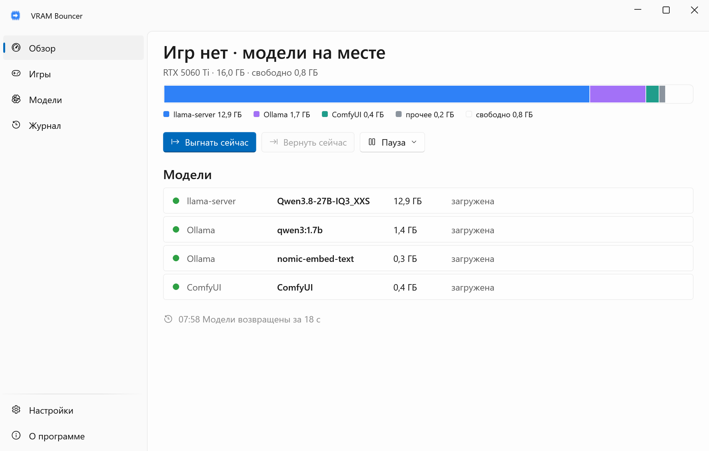
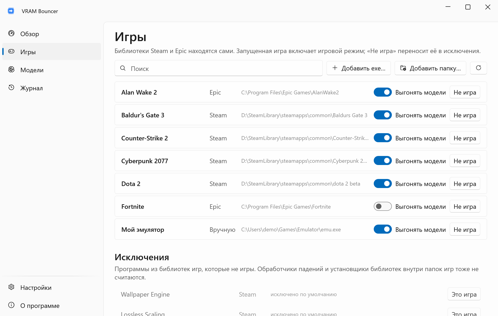
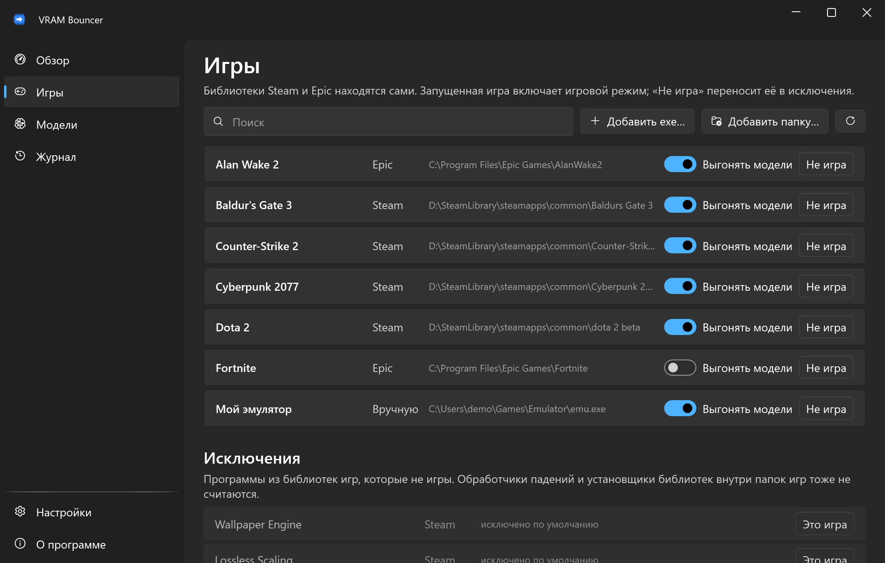
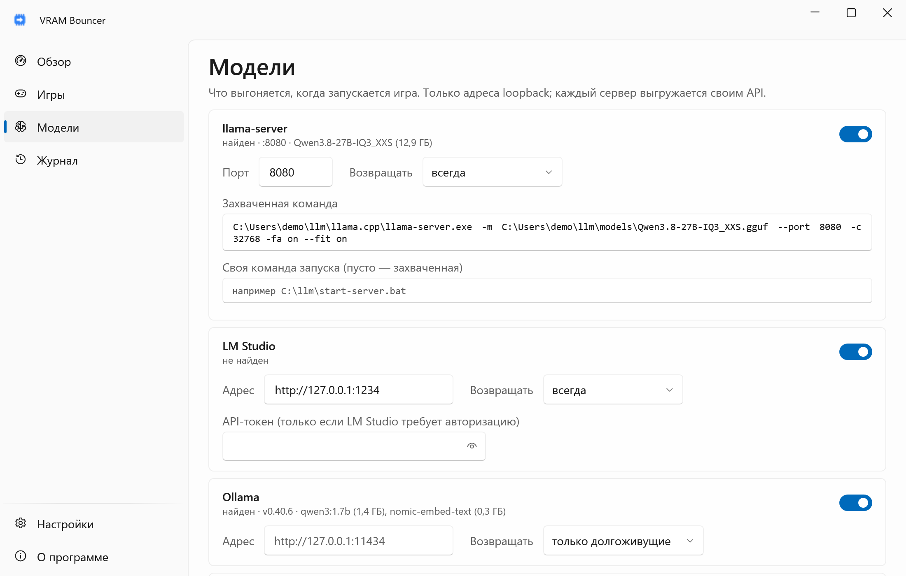
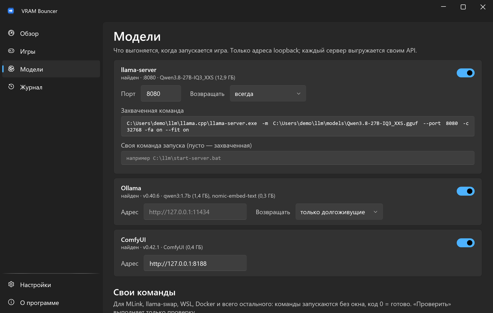
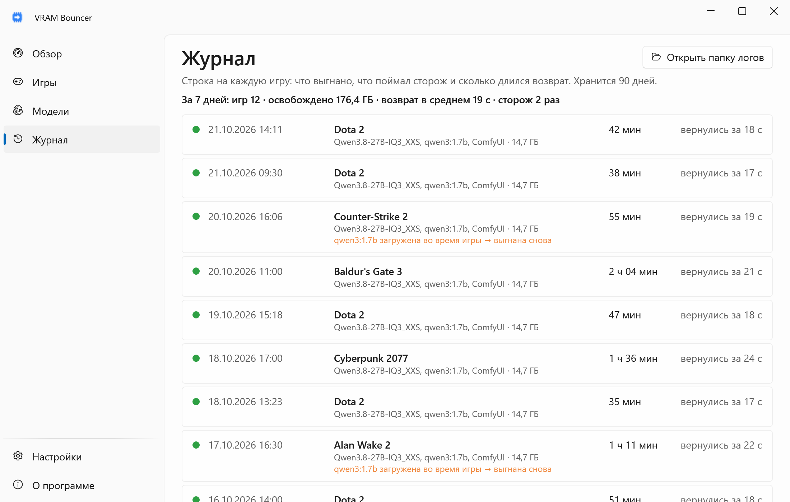
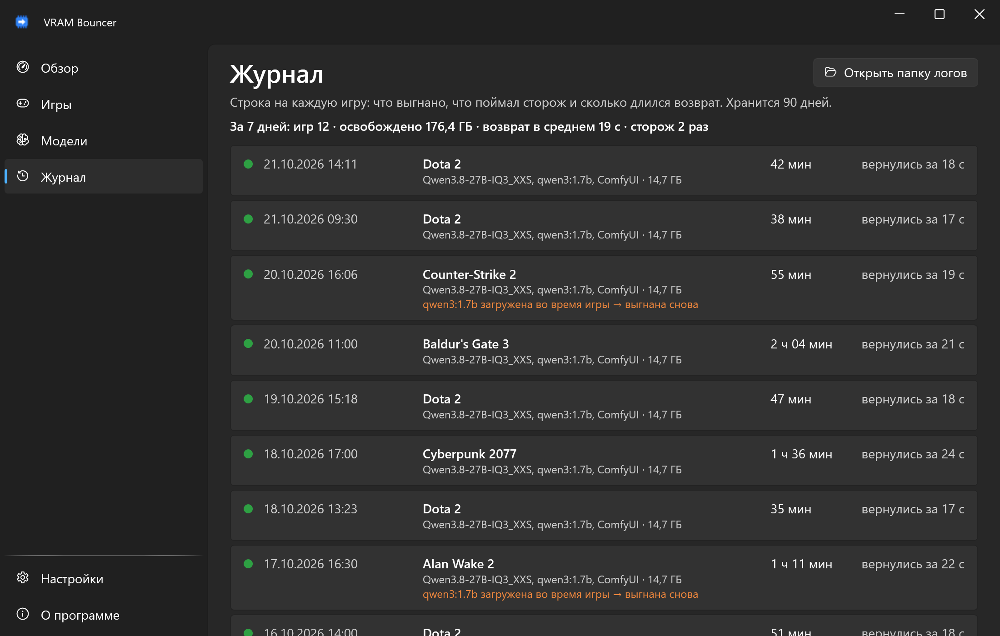

<div align="center">


# VRAM Bouncer

**Видеопамять — игре. Локальные модели вернутся, когда наиграешься.**

[English](README.md) · **Русский**

[](https://github.com/lojekq/VramBouncer/releases/latest)
[](https://github.com/lojekq/VramBouncer/releases)
[](https://github.com/lojekq/VramBouncer/actions/workflows/ci.yml)

[](LICENSE)

<picture>
  <source media="(prefers-color-scheme: dark)" srcset="docs/overview-dark-ru.png">
  
</picture>
</div>

## Зачем

Локальная модель в llama-server или Ollama спокойно занимает 13 ГБ из 16, а запущенной игре достаётся остаток: фризы, низкий FPS, вылеты.
VRAM Bouncer замечает игру, выгружает модели собственным API каждого сервера и загружает те же модели с теми же настройками, когда игра закрыта.

## Возможности

- **Сам находит игры** — библиотеки Steam и Epic читаются автоматически, всё остальное добавляется в один клик. Если программа на переднем плане держит больше 1,5 ГБ видеопамяти, VRAM Bouncer спросит: «Это игра?»
- **Выгружает правильно** — Ollama, LM Studio, llama-server (одиночный и router) и ComfyUI их собственными средствами; для всего остального (MLink, llama-swap, WSL, Docker) есть свои команды.
- **Бюджет VRAM на игру** — скажите, что Dota 2 нужно 6 ГБ, и выгрузятся только модели, без которых он не помещается, начиная с самых больших; маленькая может остаться.
- **Возвращает ту же модель** — с тем же контекстом и keep-alive, только когда игра закрыта и VRAM действительно свободна.
- **Сторож и журнал** — модель, загруженную посреди матча, выгонят снова; в журнале видно, что, когда, сколько ГБ и как долго шёл возврат.
- **Переживает падения, сон и перезагрузку** — что выгнано, записывается на диск до выгрузки.
- **Без прав администратора, без телеметрии, без вмешательства в игру** — безопасно для античитов.

## Как это работает

Раз в 2 секунды программа сверяет запущенные процессы с папками библиотек игр (`steamapps\common\…`, папки установки Epic, ваши записи).
Когда игра запускается, снимок загруженных моделей пишется в `%APPDATA%\VramBouncer\state.json`, и модели выгружаются (с бюджетом — только сколько нужно игре): Ollama через `keep_alive: 0`, LM Studio через `/api/v1/models/unload`, llama-server в режиме router через `/models/unload`, ComfyUI через `POST /free`, остальное вашей командой.
У llama-server в одиночном режиме выгрузки нет, поэтому процесс останавливается, а потом запускается снова той же командной строкой, без консольного окна.
Во время игры сторож раз в 15 с проверяет, не вернулась ли модель. После игры: пауза 60 с, ожидание, пока NVML покажет достаточно свободной VRAM (до 10 мин), и модели возвращаются по одной.

> **Что программа делает с чужими процессами.** Путь процесса читается с самым узким правом (`PROCESS_QUERY_LIMITED_INFORMATION`), расход VRAM берётся из счётчиков производительности Windows.
> Останавливается только `llama-server.exe` на порту включённого бэкенда, только если есть команда, чтобы запустить его снова, и только после записи снимка на диск.
> Запускается только этот llama-server и команды, которые вы ввели сами. Процесс игры не трогается, чужая память не читается, поверх игры ничего не рисуется.

## Как это выглядит


## Скриншоты

| | Светлая | Тёмная |
|---|---|---|
| Игры |  |  |
| Модели |  |  |
| Журнал |  |  |

## Скачать

1. **[Скачать VramBouncer.exe](https://github.com/lojekq/VramBouncer/releases/latest/download/VramBouncer.exe)** (последний релиз). Один файл, без прав администратора.
2. Сборка поменьше: [`VramBouncer-fd.zip`](https://github.com/lojekq/VramBouncer/releases/latest/download/VramBouncer-fd.zip) (нужен [.NET Desktop Runtime 10](https://dotnet.microsoft.com/download/dotnet/10.0)).
3. Проверка по желанию: `gh attestation verify <файл> -R lojekq/VramBouncer` или сверка с `SHA256SUMS.txt`.

Требования: Windows 11 x64. Windows 10 22H2 должна работать, но не тестируется. Для итога VRAM нужна видеокарта NVIDIA (NVML); на AMD и Intel всё остальное работает, а модели возвращаются после паузы.

## Первый запуск

Запустите скачанный exe откуда угодно. Сначала Windows может показать предупреждение SmartScreen (см. «Вопросы»).
Программа предложит установиться: **«Установить»** копирует её в `%LOCALAPPDATA%\Programs\VramBouncer\`, добавляет ярлык в «Пуске», автозапуск и запись в «Параметры → Приложения»; права администратора не нужны.
**«Без установки»** оставляет её портативной. Обновление: запустите новый exe так же, он заменит установленный и перезапустит его; выгнанные в этот момент модели вернутся.

Программа живёт в трее: зелёная иконка — обычный режим, оранжевая — игровой, серая — пауза.
Откройте **Модели** и нажмите **Проверить выгрузку (без действий)**: будет список того, что выгрузится, без выполнения.

Если llama-server перезапускает другая программа (сторож, лаунчер вроде MLink), выключите бэкенд llama-server и добавьте её команды остановки и запуска в **Свои команды**. Для MLink программа предложит это сама.

## Настройки

| Настройка | По умолчанию | Что делает |
|---|---|---|
| Игры → Выгонять модели | у каждой игры вкл. | Для каждой игры: включает ли её запуск игровой режим |
| Игры → ГБ | пусто | Бюджет VRAM игры: выгружаются только модели, без которых он не помещается, начиная с самых больших. Пусто — выгружать всё |
| Модели → порт llama-server | 8080 | Какой llama-server останавливается и запускается снова |
| Модели → адрес Ollama | `OLLAMA_HOST` или `127.0.0.1:11434` | Только адреса loopback |
| Модели → LM Studio | `127.0.0.1:1234`, без токена | REST API LM Studio 0.4+; токен нужен, только если LM Studio требует авторизацию, и хранится зашифрованным для вашего пользователя Windows (DPAPI). С выключенным сервером VRAM освобождает `lms unload --all` |
| Модели → Возвращать | Ollama: только долгоживущие, llama-server: всегда | Модели Ollama, которым осталось ≤ 30 мин, не загружаются снова: Ollama загрузит их по первому запросу |
| Свои команды | нет | «Выгрузить», «Вернуть» и необязательная «Проверка» (код 0 = загружена); запускаются без окна |
| Пауза после игры | 60 с | Столько времени нет ни одного процесса игры → модели возвращаются |
| Запас VRAM | 0,5 ГБ | Возврат ждёт, пока свободно ≥ выгнанное + запас |
| Ждать свободную VRAM | 10 мин | Потом модели возвращаются всё равно, с предупреждением |
| Сторож | 15 с | Во время игры загруженную снова модель выгоняет снова |
| Убивать llama-server, даже если не смогу вернуть | выкл. | Без прочитанной команды запуска сервер не трогается |
| Запускать вместе с Windows, ярлык в «Пуске» | вкл. после установки | Стартует в трее; ярлык в «Пуске» |
| Установка | — | «Установить», а у установленной — «Удалить» |
| Язык, тема, обновления | как в Windows / вкл. | Как обычно |

Данные лежат в `%APPDATA%\VramBouncer`: `settings.json`, `state.json`, `history.jsonl` (90 дней), `logs\` (в том числе `llama-server.log` перезапущенного сервера).

## Вопросы

<details><summary>«Система Windows защитила ваш компьютер» / SmartScreen</summary>

У exe пока нет цифровой подписи, поэтому Windows не знает издателя. Нажмите **Подробнее → Выполнить в любом случае**.
Каждый файл собирает GitHub Actions из этого репозитория; проверить можно через `gh attestation verify` или `SHA256SUMS.txt`.
Smart App Control, если он включён, блокирует неподписанные файлы без возможности разрешить; остаётся только выключить его.
</details>

<details><summary>Антивирус ругается</summary>

Это ложное срабатывание: у программы нет упаковщика и обфускации, устанавливается она только в папку пользователя, но она останавливает и запускает процесс llama-server, а это не нравится некоторым эвристикам.
Сообщите о нём производителю антивируса и откройте issue с названием детекта и SHA256 файла.
</details>

<details><summary>Это безопасно для античитов (VAC, EasyAntiCheat, BattlEye)?</summary>

Программа только читает путь процесса игры с самым узким правом и расход VRAM из счётчиков Windows — те же данные, что показывает Диспетчер задач.
Никаких инъекций, чтения памяти и оверлея поверх игры.
</details>

<details><summary>Что-то сразу перезапускает llama-server</summary>

Это сторож (лаунчер, скрипт, задача планировщика). VRAM Bouncer замечает сервер, который поднялся снова во время игры, больше его не трогает и сообщает причину (сводка после игры повторяет её: в полноэкранной игре Windows глушит уведомления).
Выключите бэкенд llama-server и впишите собственные команды лаунчера в **Свои команды**.
MLink находится сам: его llama-server на :8080 не останавливается, а одна кнопка **«Использовать команды MLink для :8080»** включает `off --hold` / `restore`, которые держат модель выключенной всю игру.
</details>

<details><summary>Игра не распознаётся / какая-то программа держит игровой режим</summary>

Игры не из Steam и Epic (GOG, Battle.net, эмуляторы): **Игры → Добавить exe…** или **Добавить папку…**.
Не игра в библиотеке игр (обои, оверлеи, idle-игры, которые висят постоянно): **Не игра** или выключите у неё **Выгонять модели**.
</details>

<details><summary>Как удалить?</summary>

«Настройки» → **«Удалить»** или «Параметры Windows» → «Приложения» → VRAM Bouncer → «Удалить». Настройки и логи удаляются по вашему выбору.
Если в этот момент модели выгнаны, сначала верните их («Вернуть сейчас»): пока программа — их единственный путь назад, удаляться она откажется.
Без установки: «О программе» → **«Удалить данные и автозапуск»**, затем удалите exe.
</details>

## Приватность

Без телеметрии. Сетевые запросы:
- `GET https://api.github.com/repos/lojekq/VramBouncer/releases/latest` раз в день, чтобы сообщить о новой версии; выключается в настройках;
- HTTP к включённым серверам моделей, только на адреса loopback (`127.0.0.1`, `localhost`): Ollama, LM Studio, llama-server (`/health`, у router `/models`), ComfyUI.

В логах нет заголовков окон, путей, командных строк и имён моделей. Захваченная командная строка llama-server хранится только в `state.json`, пока идёт игра.

## Сборка из исходников

```powershell
winget install Microsoft.DotNet.SDK.10
git clone https://github.com/lojekq/VramBouncer
cd VramBouncer
dotnet run --project src/VramBouncer
dotnet test
```

`--demo` показывает выдуманные данные и ничего не трогает: `dotnet run --project src/VramBouncer -- --demo`.

## Лицензия

MIT © 2026 lojekq
