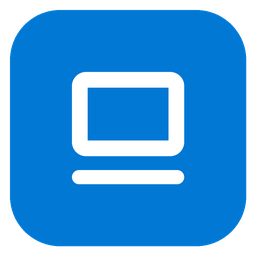
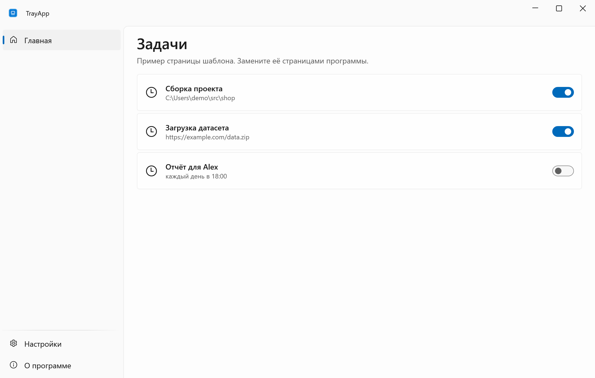
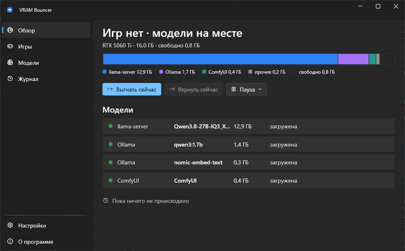
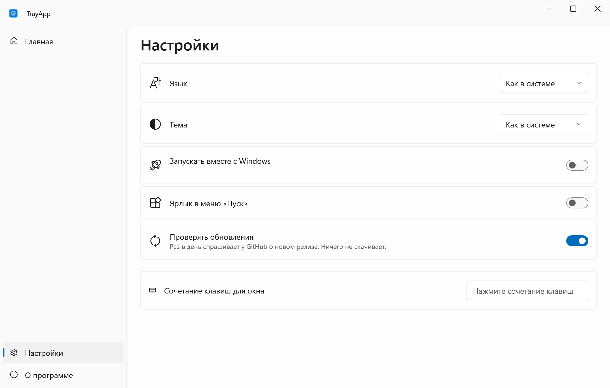
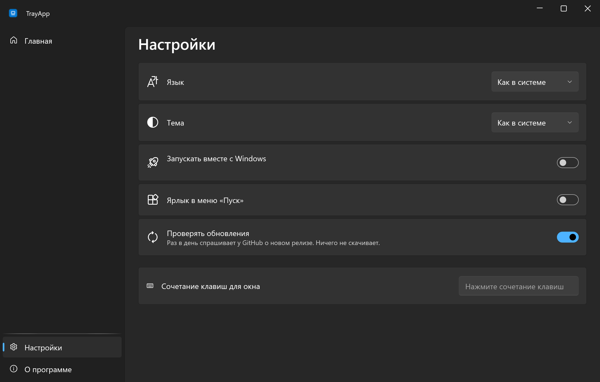
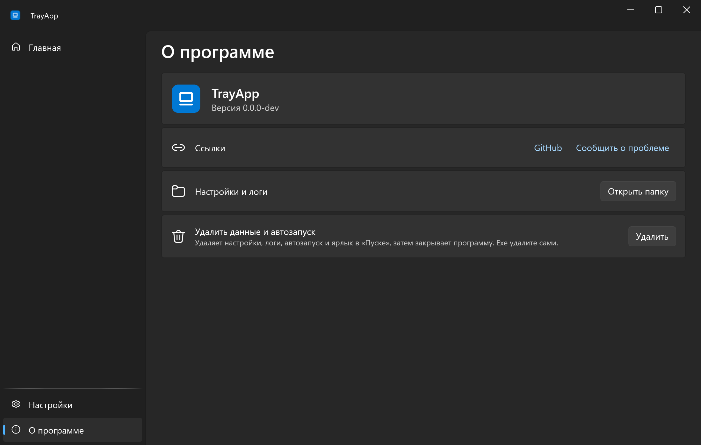

<div align="center">


# TrayApp

**Каркас небольших программ в трее Windows: один exe, RU/EN, светлая и тёмная тема, релизы из CI.**

[English](README.md) · **Русский**

[](https://github.com/lojekq/TrayAppTemplate/releases/latest)
[](https://github.com/lojekq/TrayAppTemplate/releases)
[](https://github.com/lojekq/TrayAppTemplate/actions/workflows/ci.yml)

[](LICENSE)

<picture>
  <source media="(prefers-color-scheme: dark)" srcset="docs/main-dark-ru.png">
  
</picture>
</div>

<!-- template -->
## Шаблон

Этот репозиторий — шаблон для восьми программ в трее от lojekq. `tools/rename.ps1` убирает этот раздел из программы.

**Новая программа:** `gh repo create lojekq/MyApp --private --template lojekq/TrayAppTemplate`, клон, затем
`pwsh tools/rename.ps1 -Name MyApp -Display "My App"`. Восемь программ набора создаёт `pwsh tools/new-repos.ps1 -Root <папка>`.
После fan-out шаблон заморожен: правка `Shell/` делается здесь, а в `template-fixes.md` дописывается строка.

**Устройство:** `src/TrayApp/Shell/` — общий каркас (в программах не правится), `Features/` — сама программа,
`Demo/` — данные `--demo` и сценарий `--autoplay`, `Resources/` — строки EN и RU.
Точки расширения: глаголы в `Program.Verbs`, `partial class Settings`, `SettingsPage.AppSection`, `Tray.Create(..., appItems)`,
`App.Exiting`, `App.ConfirmExit`, `App.RemoveData`, страницы в `MainWindow.xaml`; `Features/SampleSettings.cs` — пример своей секции настроек с хоткеем.
Помощники в `Shell/` для двух и более программ (00-shared §2.4): `MessageWindow`, `Hotkeys` + `HotkeyBox`, `AtomicFile`, `Install`, `ProcessInfo`,
`CmdLine`, `ConsoleTool`, `UserBusy`, `Monitors`, `TopWindows`, `WinEvents`, `ExeIcon`, `UninstallEntries`, `Paths`; подпись: `tools/sign-release.ps1`.

| Команда | Что делает |
|---|---|
| `dotnet test` | тесты, Microsoft.Testing.Platform через `global.json` |
| `pwsh tools/shots.ps1 -Pages main,settings,about` | скриншоты `docs/<страница>-<тема>-<язык>.png` в 2×, под замком рабочего стола |
| `pwsh tools/gif.ps1 [-Lang ru] [-Scene]` | `docs/demo-<язык>.gif` окна (или фиксированной области), под замком |
| `pwsh tools/social.ps1 -Title ... -Subtitle ...` | `docs/social.png` 1280×640 для social preview |
| `git tag -a v0.1.0 -m "..." -m "---" -m "..."` + push | CI собирает exe и zip, SHA256SUMS, attestation, релиз |

**Спайки (фаза 1, 2026-10-21, .NET SDK 10.0.402, Windows 11 26300):**
- Тест-проект MSTest.Sdk 4.5.1 ссылается на WPF-проект WinExe (`net10.0-windows`): `dotnet test` проходит в Debug и Release, типы WPF в тестах грузятся. MSTest.Sdk нужен `<ImplicitUsings>enable</ImplicitUsings>`, иначе `[TestClass]` без `using` не находится.
- WinExe с перенаправленным stdio (node `child_process.spawn` с pipe, как Claude Code запускает MCP-серверы, с `windowsHide` и без; и pipe из pwsh) читает и пишет через `Console.OpenStandardInput/Output`: JSON-строки, кириллица и строка в 1 МБ доходят целыми, код выхода возвращается. Консольного окна нет: `GetConsoleWindow()` = 0, PE subsystem 2 (GUI).
- Пробный тег `v0.0.1-test` при включённых immutable releases: CI собрал оба файла (self-contained exe 64.6 МБ, framework-dependent zip 3.0 МБ), SHA256SUMS сошлись, `gh attestation verify` прошёл для exe и zip, pre-release создан и помечен immutable, заметки взяты из аннотированного тега, Defender ничего не нашёл, скачанный exe запустился. Затем релиз и тег удалены (с immutable releases это разрешено).
- Конвейер на этом демо-окне при 100 %: `shots.ps1` (12 PNG, 2200×1400), оконный GIF EN/RU (800×496, 0.3 МБ), сценовый GIF на `-offset_x 1080 -offset_y 344` (область попала точно; в репо не положен: в кадре рабочий стол вокруг окна), `social.ps1` (42 КБ). Не проверено: `shots.ps1` и `gif.ps1` на мониторе со 150 % (ждёт дисплейного слота владельца).
- Помощники на ПК владельца: `Monitors.Snapshot()` даёт ровно `Layouts.Owner`; `RegisterHotKey` на сочетание, занятое другим процессом, даёт ошибку 1409, и поле показывает «занято другой программой».

**Решения шаблона (отступления от спеки):**
- CsWin32 0.3.358: 0.3.366 моложе двух недель (00-shared §2.1).
- `MessageWindow` — скрытое tool-окно верхнего уровня, а не `HWND_MESSAGE`: message-only окна не получают широковещательных сообщений (WM_SETTINGCHANGE, WM_DISPLAYCHANGE, WM_POWERBROADCAST).
- «Выключено в Диспетчере задач» — нечётный первый байт в `StartupApproved\Run` (0x03, 0x07), а не «≠ 0x02»: 0x06 тоже означает «включено».
- `shots.ps1` тоже берёт замок рабочего стола: его окно поверх всех попало бы в GIF другой сессии.
<!-- /template -->

## Зачем

Каждой маленькой утилите для Windows нужны одни и те же скучные части: значок в трее, настройки, автозапуск, два языка, лог падений и релиз с контрольными суммами.
В TrayApp они сделаны один раз, и программа добавляет только свои страницы.

## Возможности

- **Живёт в трее** — левый клик открывает окно, крестик прячет его, «Выход» в меню трея.
- **Один exe** — без установщика и прав администратора; ярлык в «Пуске» и автозапуск включаются в настройках.
- **Русский и английский, светлая и тёмная тема** — как в Windows или по вашему выбору.
- **Честные обновления** — раз в день спрашивает у GitHub о новом релизе, показывает заметку и ничего не скачивает.
- **Лог падений** — при ошибке программа останавливается и показывает, где лог; ничего никуда не отправляется.

## Как это выглядит



## Скриншоты

| | Светлая | Тёмная |
|---|---|---|
| Настройки |  |  |
| О программе |  |  |

## Скачать

1. Скачайте **`TrayApp-x.y.z-win-x64.exe`** из [Releases](https://github.com/lojekq/TrayAppTemplate/releases/latest). Один файл, без установки и прав администратора.
2. Сборка поменьше: `TrayApp-x.y.z-win-x64-fd.zip` (нужен [.NET Desktop Runtime 10](https://dotnet.microsoft.com/download/dotnet/10.0)).
3. Проверка по желанию: `gh attestation verify <файл> -R lojekq/TrayAppTemplate` или сверка с `SHA256SUMS.txt`.

Требования: Windows 11 x64. Windows 10 22H2 должна работать, но не тестируется.

## Первый запуск

Сначала положите exe в постоянную папку, например `%LOCALAPPDATA%\Programs\TrayApp\`: автозапуск и ярлык указывают на него.
При первом запуске Windows может показать предупреждение SmartScreen (см. «Вопросы»). Дальше программа живёт в трее; в настройках включите **«Запускать вместе с Windows»**.

## Настройки

| Настройка | По умолчанию | Что делает |
|---|---|---|
| Язык | язык Windows | русский или английский, после перезапуска |
| Тема | тема Windows | светлая или тёмная |
| Запускать вместе с Windows | выкл. | стартует свёрнутой в трей |
| Ярлык в меню «Пуск» | вкл., если exe лежит в `%LOCALAPPDATA%\Programs\TrayApp\` | ярлык в «Пуске» |
| Проверять обновления | вкл. | раз в день спрашивает у GitHub о новом релизе |

Настройки и логи лежат в `%APPDATA%\TrayApp`.

## Вопросы

<details><summary>«Система Windows защитила ваш компьютер» / предупреждение SmartScreen</summary>

Exe пока без цифровой подписи, поэтому Windows не знает издателя. Нажмите **«Подробнее» → «Выполнить в любом случае»**.
Каждый файл собирает GitHub Actions из этого репозитория; проверить его можно через `gh attestation verify` или `SHA256SUMS.txt`.
Если включён Smart App Control, он блокирует неподписанные файлы без возможности разрешить один; остаётся только выключить его.
</details>

<details><summary>Антивирус ругается на программу</summary>

Это ложное срабатывание: у программы нет установщика, упаковщика и обфускации. Сообщите об этом производителю антивируса
и откройте issue с именем детекта и SHA256 файла.
</details>

<details><summary>Как удалить?</summary>

«О программе» → **«Удалить данные и автозапуск»**, затем удалите exe.
</details>

## Приватность

Телеметрии нет. Единственный сетевой запрос — проверка обновлений: `GET https://api.github.com/repos/lojekq/TrayAppTemplate/releases/latest` раз в день; выключается в настройках.
В логах нет заголовков окон, путей и других личных данных.

## Сборка из исходников

```powershell
winget install Microsoft.DotNet.SDK.10
git clone https://github.com/lojekq/TrayAppTemplate
cd TrayAppTemplate
dotnet run --project src/TrayApp
dotnet test
```

## Лицензия

MIT © 2026 lojekq
